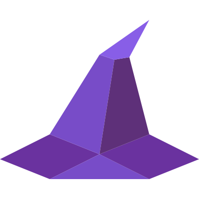

# WizardChat - Simple, Secure, Magical

WizardChat is a Matrix client. End-to-end encrypted, open source, and works in your browser, as a desktop app for Windows,
macOS and Linux, and as a native app for iOS and Android. All apps share one Rust core built on matrix-rust-sdk.

## Features

- E2EE
- Direct messages and Spaces
- Voice and video calls (1:1 and group, via MatrixRTC + LiveKit)
- Screen sharing
- File, image, and video sharing
- Pin messages
- Message search
- Threads
- Message reactions, edits, and replies
- Advanced Message formatting
- Typing indicators
- Custom Stickers and Emojis
- GIFs
- SSO login
- Read receipts
- Themes (Carbon, Pewter, Umbra, Eclipse, Parrot, Hallow, Ethereal, Blossom, Garnet)

## Try out WizardChat

### Web

- **Stable**: [rust.wizardchat.org](https://rust.wizardchat.org)
- **Next** (pre-release): [next-rust.wizardchat.org](https://next-rust.wizardchat.org)

### Desktop

Windows (installer), macOS (Apple Silicon, DMG) and Linux (AppImage): download from [wizardchat.org](https://wizardchat.org)
or the [releases page](https://gitlab.com/wizardchat/wizardchat/-/releases). The app updates itself.

> **macOS:** the app isn't signed yet, so macOS may block it the first time. Open **System Settings -> Privacy & Security**,
> scroll down to **Security** and click **Allow WizardChat**.

### iOS and Android

Not in the stores yet, but you can build them yourself (see Local Development).

## Local Development

- [Development](docs/DEVELOPMENT.md): setting up, running the apps, checks
- [Building and releasing](docs/BUILDING.md)
- [Contributing](docs/CONTRIBUTING.md): where code goes and the conventions

### Using Docker

- Just pull the newest docker image from [Gitlab Container Registry](https://gitlab.com/wizardchat/wizardchat/container_registry/)

## License

- **Code:** [AGPL-3.0](LICENSE). Forks and modified versions must stay under the AGPL, and if you host a modified version,
  its users must be able to get the source code.
- **Logo and app icons** (`apps/web/public/assets/images/logo*.svg` and the app icons in `apps/`):
  [CC BY-SA 4.0](https://creativecommons.org/licenses/by-sa/4.0/), © WizardChat. Share and adapt them with attribution,
  under the same license.
- **Name:** the licenses don't cover the WizardChat name. If you publish a fork, please give it its own name and logo so it
  isn't mistaken for the official app.
