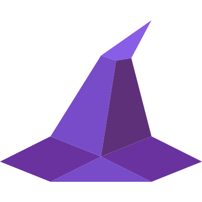
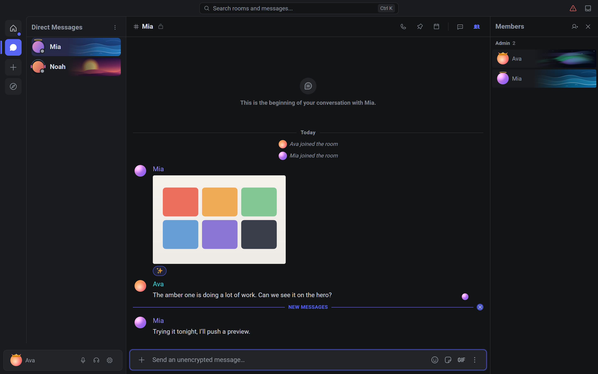
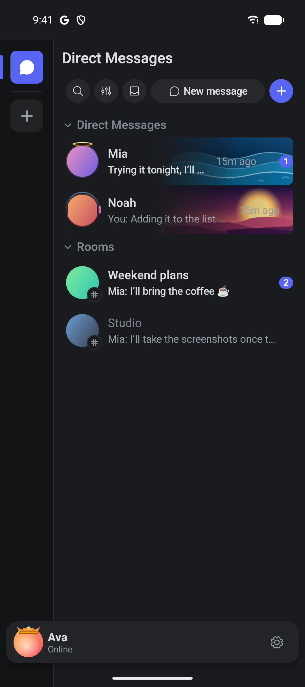
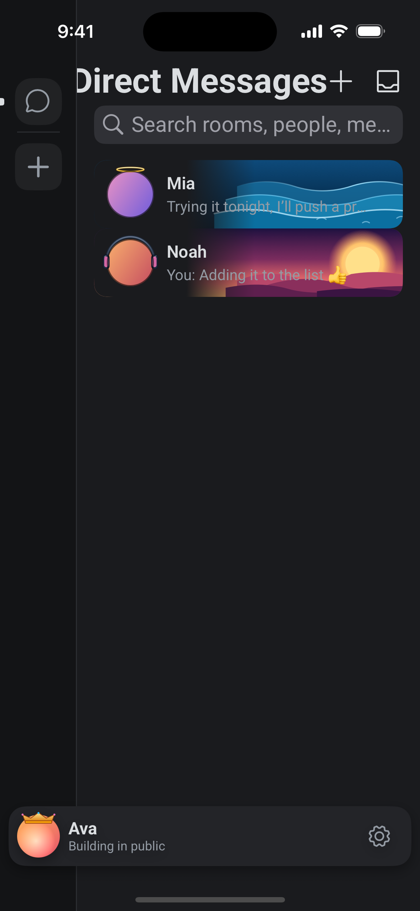
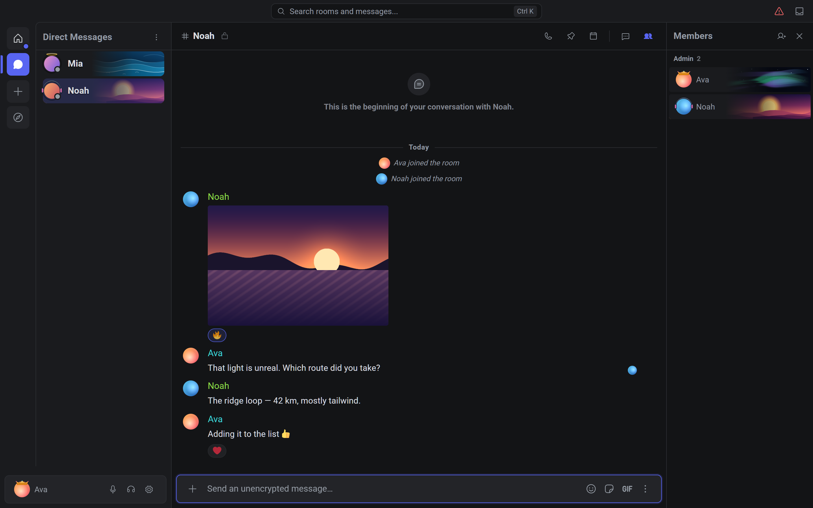
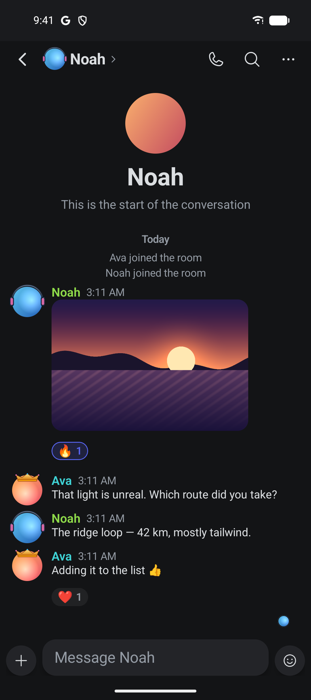
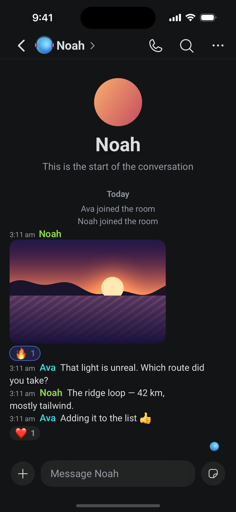

# Mudrix - Simple, Secure, Muddy


[](https://github.com/kapsikkum/mudrix/releases)

Mudrix is a Matrix client. End-to-end encrypted, open source, and available in your browser, on Windows, macOS and
Linux, and on Android and iOS.

## Try it

| Where                     | How                                                                                                                                                                |
| ------------------------- | ------------------------------------------------------------------------------------------------------------------------------------------------------------------ |
| **Web**                   | Open <https://kapsikkum.github.io/mudrix/>. Nothing to install.                                                                                                    |
| **Windows, macOS, Linux** | Download the installer from the [latest release](https://github.com/kapsikkum/mudrix/releases/latest). The app updates itself.                                     |
| **Android**               | Download the APK from the [latest release](https://github.com/kapsikkum/mudrix/releases/latest), or add `https://kapsikkum.github.io/apps/fdroid/repo` to F-Droid. |
| **iOS**                   | Add `https://kapsikkum.github.io/apps/sidestore.json` to [SideStore](https://sidestore.io) (iOS 18), or sideload `Mudrix-unsigned.ipa` from the release.           |

The installers are not code-signed, so your system warns the first time:

- **Windows:** click "More info", then "Run anyway".
- **macOS (Apple silicon):** open **System Settings -> Privacy & Security** and click **Open Anyway**.
- **Linux:** make the AppImage executable (`chmod +x`) and run it, or install the `.deb` or `.rpm`.

## Features

- End-to-end encryption, with device verification and key backup
- Direct messages and Spaces
- Voice and video calls with screen sharing
- Threads, replies, reactions, edits and pinned messages
- Stickers, emojis and GIFs, files, images, video, voice messages, polls and location sharing
- Profiles with a bio, avatar decorations and frames
- Sign in with SSO, OAuth or a QR code, and multiple accounts
- 29 themes, custom themes, and 11 languages

## Screenshots

| Web                                                                                                 | Android                                                                                                 | iOS                                                                                             |
| --------------------------------------------------------------------------------------------------- | ------------------------------------------------------------------------------------------------------- | ----------------------------------------------------------------------------------------------- |
|  |  |  |
|              |              |              |

## For developers

```sh
npm install
npm run core:web:dev   # builds the core for the browser once
npm run dev            # web app on http://localhost:5180
```

Rust (rustup), wasm-pack and Node 22+ are needed. More in [Development](docs/DEVELOPMENT.md),
[Building](docs/BUILDING.md), [Releasing](RELEASING.md) and [Contributing](CONTRIBUTING.md).

## Based on WizardChat

Mudrix is a fork of [WizardChat](https://gitlab.com/wizardchat/wizardchat)'s Rust-core rewrite and keeps its
AGPL-3.0 licence. The core, the native iOS and Android apps and much of the web client come from WizardChat, (c) its
authors; Mudrix adds its own features on top.

## License

- **Code:** [AGPL-3.0](LICENSE). Forks and modified versions must stay under the AGPL, and if you host a modified version,
  its users must be able to get the source code.
- **Logo and app icons:** the Mudrix logo is original Mudrix artwork. Upstream's own logo and icons are
  [CC BY-SA 4.0](https://creativecommons.org/licenses/by-sa/4.0/), (c) WizardChat; the few places that still use them are
  listed in [docs/BRANDING.md](docs/BRANDING.md) and are being replaced.
- **Name:** the licences don't cover the WizardChat name, and Mudrix is not the official WizardChat app.
